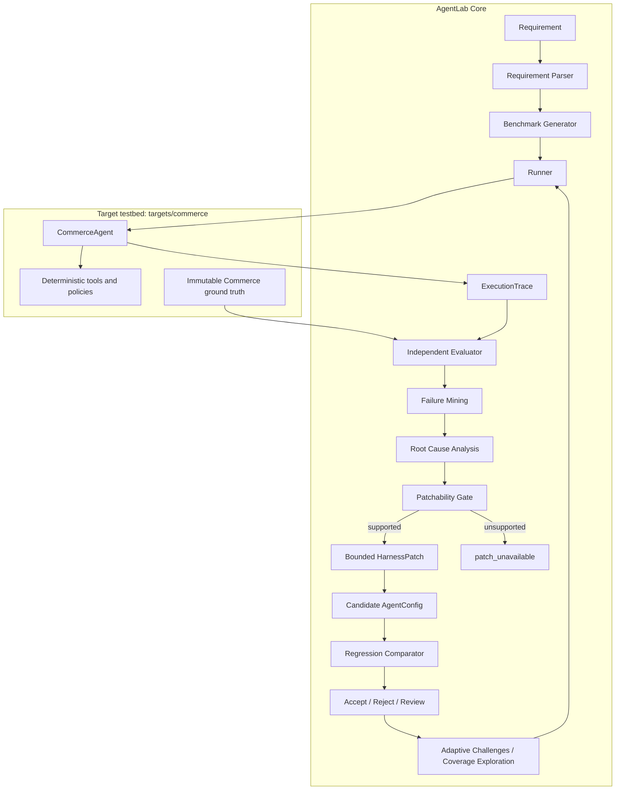

# AgentLab

AgentLab is a bounded self-improving harness system for AI agents. It does not
only report whether a Target Agent failed: it executes benchmarks, evaluates
behavior independently, mines recurring failures, diagnoses evidence-backed
root causes, checks whether they are patchable, applies bounded harness changes,
and reruns regression. It also probes additional weaknesses through adaptive
and coverage-driven challenges.

The included Commerce Agent is the first Target Agent testbed. It is not
AgentLab Core.

## Verified demo story

The deterministic and controlled demo currently produces this evolution:

| Stage | Evidence |
| --- | --- |
| V1 | 5/7 fixed regression cases pass; `workflow.max_steps = 2` |
| Failure | CT6 and CT7 fail with `workflow_step_limit` |
| Patch #1 | `workflow.max_steps: 2 -> 3` |
| V2 | 7/7 pass; regression decision `ACCEPT` |
| Adaptive challenges | AC1-AC5 pass 5/5 |
| Coverage exploration | EX2 reveals a product-vs-promotion tool-selection weakness |
| Deterministic EX2 | `patch_unavailable`, because fallback routing ignores prompt/context/tool-description fields |
| Controlled V2 EXT2 | Calls `search_policy`; fails |
| Patch #2 | Adds one negated-intent routing instruction to `system_prompt` |
| Controlled V3 EXT2 | Calls `search_products`; passes |
| Full controlled validation | V2 15/16 -> V3 16/16; no regressions; decision `ACCEPT` |

The second optimization is **provider-independent controlled mock-router
evidence**. It demonstrates causal sensitivity to `AgentConfig`; it is not a
claim that every external model will behave identically.

## Architecture



AgentLab Core communicates with the target through the stable Target Agent
interface. The target receives `TestCase` and `AgentConfig`; evaluator-only
ground truth is never supplied to it.

## Evidence levels

### A. Deterministic evidence

Commerce fixtures, deterministic tools, immutable ground truth, fixed regression
evaluation, the V1 -> V2 workflow patch, adaptive generation, coverage analysis,
and the deterministic EX2 patchability result.

### B. Controlled mock-router evidence

A fixed provider-independent router is used for both baseline and candidate.
Only allowed `AgentConfig` fields differ. This proves that the bounded V2 -> V3
prompt change can causally change routing in the controlled experiment.

### C. Optional external-model evidence

`scripts/real_model_smoke.py` can repeat EX2 against one OpenAI-compatible provider and
report V2/V3 success counts. This is supplementary, is never used by normal
tests, and has **not been run in the verified project environment because no
credentials were configured**.

## Project structure

| Path | Responsibility |
| --- | --- |
| `app/schemas/` | Shared validated Pydantic contracts for all module boundaries. |
| `app/requirement/` | Converts raw requirements into a validated `RequirementSpec`. |
| `app/benchmark/` | Generates traceable generic benchmark cases. |
| `app/runner/` | Invokes a Target Agent and owns trace identity and observability. |
| `app/debugger/` | Groups failures and produces evidence-backed root causes. |
| `app/optimizer/` | Proposes and applies bounded, reversible harness patches. |
| `app/regression/` | Compares real baseline and candidate evaluation results. |
| `app/llm/` | Optional provider adapter outside the deterministic core path. |
| `app/targets/commerce/` | Commerce Agent, tools, policies, scenarios, evaluator, and challenge experiments. |
| `tests/` | Unit and integration coverage; no live model calls. |
| `scripts/demo.py` | Reproduces the complete local CLI evidence story. |
| `scripts/real_model_smoke.py` | Optional repeated external-model EX2 comparison. |

## Quickstart on Windows PowerShell

From the repository root:

```powershell
python -m venv .venv
.\.venv\Scripts\Activate.ps1
python -m pip install -r requirements.txt
python -m pytest
python scripts/demo.py
```

Run the current FastAPI + Next.js product UI:

```powershell
# Backend (from the repository root)
python -m uvicorn api.main:app --reload --port 8001

# Frontend (from frontend/)
cd frontend
npm run dev -- --port 3000
```

Open `http://localhost:3000`. If runtime behavior does not match the source
code, verify the processes serving ports 8001 and 3000 before changing
application logic.

Normal tests and the deterministic CLI demo require no API key and make no live
LLM calls.

## Optional external-model smoke test

The adapter uses an OpenAI-compatible `/chat/completions` endpoint. Configure
one provider in the current PowerShell session; never commit real credentials:

```powershell
$env:AGENTLAB_LLM_API_KEY = "your-api-key"
$env:AGENTLAB_LLM_BASE_URL = "https://your-provider.example/v1"
$env:AGENTLAB_LLM_MODEL = "your-model-name"
$env:AGENTLAB_LLM_TIMEOUT_SECONDS = "30"
python scripts/real_model_smoke.py --repetitions 5
```

`.env.example` documents the supported names, but the project intentionally
does not auto-load `.env` files. Export the variables in the shell or inject
them through your execution environment.

The smoke test uses the same `CommerceAgent`, model/provider, EX2 input,
evaluator, and ground truth for V2 and V3. If V2 already succeeds, that result
is reported without manufacturing a failure.

## Design principles

- The Target Agent never evaluates itself.
- Ground truth is immutable and evaluator-only.
- Baseline and candidate use the same benchmark for regression.
- Each new `AgentConfig` is a separate version; earlier versions are preserved.
- The optimizer may modify only `system_prompt`, `tool_description`, `context`,
  or `workflow_config`.
- Unsupported execution paths return `patch_unavailable` rather than fabricated
  patches.
- Passing all known tests does not automatically trigger another patch.
- Adaptive and coverage-driven challenges remain separate from the fixed
  regression benchmark.
- Deterministic, controlled mock-router, and optional external-model claims are
  reported separately.

## Current scope

AgentLab is an MVP and Commerce is its only target testbed. There is no database,
authentication, deployment layer, autonomous source-code editing, LLM judge,
LangGraph, MCTS, or open-ended optimization loop.
