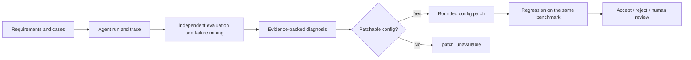

<p align="center">
  <h1 align="center">AgentLab</h1>
  <p align="center"><strong>Turn agent failures into evidence you can diagnose, patch, and regression-test.</strong></p>
  <p align="center">An experimental harness-optimization platform for AI agents: run benchmarks, identify failure causes, propose bounded configuration patches, and verify them with regression tests.</p>
</p>

<p align="center"><a href="#demo-walkthrough">Demo</a> · <a href="#results">Results</a> · <a href="#workflow">Workflow</a> · <a href="#run-locally">Run locally</a> · <a href="README_ZH.md">简体中文</a></p>

> **Project:** AI Agent Evaluation / Harness Optimization　**Stage:** MVP　**Test target:** Commerce Agent
>
> **Evidence boundary:** V1→V2 results come from deterministic Commerce tests. V2→V3 comes from a controlled experiment with a fixed mock router. The optional external-model smoke test has not been run, so controlled results are not presented as real-model performance.

## Demo walkthrough

### Scenario A: diagnose and fix a workflow step limit

The Commerce Agent must find the applicable promotion and then check gift eligibility. CT6 uses this input:

```text
My order was paid on 2026-02-10 for 650 RMB.
Which promotion applies, and do I qualify for the gift?
```

- **V1 trace:** `workflow.max_steps = 2`. After calling `search_policy`, the agent has no remaining step to call `check_eligibility`. CT6 and CT7 fail with `workflow_step_limit`.
- **Failure analysis:** An independent evaluator checks the tool-call trace against immutable ground truth. Failure mining groups the two cases into the same workflow step-limit pattern.
- **Patch #1:** Increase `workflow_config.max_steps` from `2` to `3`. This changes harness configuration; it does not edit agent source code.
- **V2 regression:** The same CT1–CT7 regression set moves from **5/7 to 7/7**, with an **ACCEPT** decision.

### Scenario B: explore a routing weakness and run a controlled comparison

Separately generated adaptive challenges and coverage exploration reveal EX2: a user asks for running shoes while explicitly excluding promotion intent, but the agent may still choose `search_policy`.

- **V2 controlled baseline:** A fixed mock router sends EX2 to `search_policy`; evaluation fails.
- **Patchability gate:** The deterministic Commerce router does not read prompt, context, or tool-description fields. AgentLab reports `patch_unavailable` instead of proposing an ineffective patch.
- **Controlled routing experiment:** A fixed, provider-independent mock router is used for both versions with the same input, evaluator, and ground truth. Only an allowed `system_prompt` field changes, adding a rule for negated intent.
- **V3 comparison:** The route changes from `search_policy` to `search_products`, and EX2 passes. On the full validation set, results improve from **15/16 to 16/16**, with no known regressions and a final **ACCEPT** decision.

> V2→V3 shows that the configuration change affected behavior in this controlled router experiment. It does not establish that every real model will behave the same way.

<!-- The repository currently has no stable screenshot or GIF asset to reference. This section uses a reproducible case, trace, patch, and regression result instead of a broken image placeholder. -->

## Results

| Validation set | Purpose | V2 | V3 |
|---|---|---:|---:|
| Fixed regression CT1–CT7 | Protect known behavior and verify Patch #1 | 7/7 | 7/7 |
| Adaptive Challenges AC1–AC5 | Generate challenges from observed failure evidence | 5/5 | 5/5 |
| Coverage Exploration EX1–EX4 | Probe behavior not covered by the fixed set | 3/4 | 4/4 |
| **Total** | Fixed, adaptive, and exploratory cases | **15/16** | **16/16** |

AgentLab reports results by test set so an aggregate score cannot hide changes across different kinds of cases.

## Workflow



### Design principles

- The target agent does not grade itself; immutable ground truth is evaluator-only.
- Baseline and candidate use the same benchmark for comparison.
- Each candidate `AgentConfig` is versioned; previous configurations are preserved.
- Allowed patch fields are `system_prompt`, `tool_description`, `context`, and `workflow_config`.
- Unsupported or unpatchable paths return `patch_unavailable`.
- Fixed regression, Adaptive Challenges, and Coverage Exploration are reported separately.

## Tech stack

| Area | Technology / implementation |
|---|---|
| Backend API | Python, FastAPI, Pydantic |
| Web UI | Next.js, React, TypeScript |
| Test target | Commerce Agent with deterministic tools and promotion policies |
| Validation | pytest, fixed test cases, independent evaluator, immutable ground truth |
| Optional model adapter | OpenAI-compatible Chat Completions; the default demo makes no live model calls |

## Repository structure

| Path | Responsibility |
|---|---|
| `app/schemas/` | Shared data contracts across module boundaries |
| `app/requirement/` | Convert raw requirements into structured specifications |
| `app/benchmark/` | Generate traceable benchmark cases |
| `app/runner/` | Invoke the target agent and record traces |
| `app/debugger/` | Failure mining and evidence-backed diagnosis |
| `app/optimizer/` | Bounded, reversible harness configuration patches |
| `app/regression/` | Compare baseline and candidate evaluation results |
| `app/targets/commerce/` | Commerce agent, tools, scenarios, evaluator, and challenge experiments |
| `frontend/` | Next.js product UI |
| `tests/` | Unit and integration tests; no live model calls |
| `scripts/demo.py` | Run the complete local CLI evidence demo |
| `scripts/real_model_smoke.py` | Optional external-model EX2 comparison |

## Run locally

### CLI demo

```powershell
python -m venv .venv
.\.venv\Scripts\Activate.ps1
python -m pip install -r requirements.txt
python scripts/demo.py
```

The CLI prints the V1 baseline, failure pattern, root cause, patch, V2 regression, challenge cases, controlled EX2 comparison, and final decision. No API key is required and no live model is called.

### Web UI

```powershell
# From the repository root: start the backend
python -m uvicorn api.main:app --reload --port 8001

# In a new terminal: start the frontend
cd frontend
npm install
npm run dev -- --port 3000
```

Open `http://localhost:3000`.

### Optional external-model smoke test

Configure an OpenAI-compatible `/chat/completions` service, then run:

```powershell
$env:AGENTLAB_LLM_API_KEY = "your-api-key"
$env:AGENTLAB_LLM_BASE_URL = "https://your-provider.example/v1"
$env:AGENTLAB_LLM_MODEL = "your-model-name"
$env:AGENTLAB_LLM_TIMEOUT_SECONDS = "30"
python scripts/real_model_smoke.py --repetitions 5
```

Never commit API credentials. Record the provider, model, repetitions, and V2/V3 results separately for external-model runs.

## Scope and limitations

AgentLab is currently an MVP, and Commerce is its only target agent. It optimizes harness configuration and does not autonomously edit application source code. The default demo does not use an LLM judge and does not depend on LangGraph, MCTS, a database, authentication, or an open-ended autonomous optimization loop. External-model validation requires separately configured credentials and an explicit smoke-test run.

---

<p align="center"><sub>AgentLab · Evidence-driven Harness Optimization for AI Agents</sub></p>
