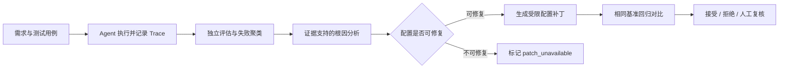

<p align="center">
  <h1 align="center">AgentLab</h1>
  <p align="center"><strong>让 Agent 的失败，变成可定位、可修复、可回归验证的证据链。</strong></p>
  <p align="center">一个面向 AI Agent 的 Harness 优化实验平台：运行基准测试、定位失败原因、提出受限配置补丁，并用回归测试验证改动。</p>
</p>

<p align="center"><a href="#项目演示">项目演示</a> · <a href="#核心结果">核心结果</a> · <a href="#工作流程">工作流程</a> · <a href="#本地运行">本地运行</a> · <a href="README.md">English</a></p>

> **项目类型：** AI Agent Evaluation / Harness Optimization　**项目阶段：** MVP　**测试对象：** Commerce Agent
>
> **证据说明：** V1→V2 来自确定性 Commerce 测试；V2→V3 来自固定 mock-router 的受控实验。外部大模型 Smoke Test 尚未运行，因此不将受控结果表述为真实模型效果。

## 项目演示

### 场景 A：定位并修复工作流步数不足

Commerce Agent 需要先查找适用促销，再判断用户是否满足赠品条件。测试 CT6 的输入是：

```text
My order was paid on 2026-02-10 for 650 RMB.
Which promotion applies, and do I qualify for the gift?
```

- **V1 Trace：** `workflow.max_steps = 2`。Agent 调用 `search_policy` 后，剩余步数不足，未能调用 `check_eligibility`；CT6、CT7 因 `workflow_step_limit` 失败。
- **失败分析：** 独立评估器检查工具调用轨迹与固定 ground truth；失败聚类将两个案例归为同一类工作流步数问题。
- **Patch #1：** 将 `workflow_config.max_steps` 从 `2` 调整为 `3`。补丁针对 Harness 配置，不改 Agent 源码。
- **V2 回归：** 使用相同的 CT1–CT7 回归集，结果从 **5/7 提升到 7/7**，决策为 **ACCEPT**。

### 场景 B：探索工具路由弱点并做受控对照

通过独立生成的 Adaptive Challenges 与 Coverage Exploration，系统发现 EX2：用户提到跑鞋和促销，但明确排除了促销意图，Agent 仍可能错误地选择 `search_policy`。

- **V2 受控基线：** 固定 mock-router 将 EX2 路由到 `search_policy`，评估失败。
- **Patchability Gate：** 确定性 Commerce 路由器不读取 prompt/context/tool description 字段，系统因此标记 `patch_unavailable`，不伪造一个无效补丁。
- **受控路由实验：** 换用固定且 provider-independent 的 mock-router，在同一 Router、输入、评估器和 ground truth 下，仅调整允许修改的 `system_prompt`，加入处理否定意图的规则。
- **V3 对照：** 路由由 `search_policy` 变为 `search_products`，EX2 通过；在完整验证集上从 **15/16 提升到 16/16**，无已知回归，最终决策为 **ACCEPT**。

> V2→V3 证明的是该配置在受控路由实验中改变了行为；它不能证明所有真实模型都会有相同表现。

<!-- 演示界面：仓库内当前无可稳定引用的截图/GIF，因此此处用可复现的案例、Trace、补丁差异和回归结果说明演示，不展示占位图。 -->

## 核心结果

| 验证集 | 用途 | V2 | V3 |
|---|---|---:|---:|
| 固定回归 CT1–CT7 | 保护已知能力并验证 Patch #1 | 7/7 | 7/7 |
| Adaptive Challenges AC1–AC5 | 从既有失败模式生成挑战 | 5/5 | 5/5 |
| Coverage Exploration EX1–EX4 | 探索尚未覆盖的行为 | 3/4 | 4/4 |
| **合计** | 固定、挑战与探索用例 | **15/16** | **16/16** |

AgentLab 报告分集结果，避免只用总分掩盖不同类型用例的变化。

## 工作流程



### 设计重点

- 被测 Agent 不负责给自己打分；ground truth 只提供给独立评估器。
- 基线与候选版本使用同一组基准用例进行比较。
- 每个候选 `AgentConfig` 单独版本化，保留原配置。
- 仅允许修改 `system_prompt`、`tool_description`、`context`、`workflow_config`。
- 不可修复或不支持的路径显式返回 `patch_unavailable`。
- 固定回归、Adaptive Challenges 和 Coverage Exploration 分开报告。

## 技术栈

| 部分 | 技术 / 实现 |
|---|---|
| 后端 API | Python、FastAPI、Pydantic |
| Web 界面 | Next.js、React、TypeScript |
| 测试对象 | Commerce Agent、确定性工具与促销策略 |
| 验证 | pytest、固定测试集、独立评估器、不可变 ground truth |
| 可选模型适配 | OpenAI-compatible Chat Completions；默认演示不调用在线模型 |

## 项目结构

| 路径 | 职责 |
|---|---|
| `app/schemas/` | 模块边界共享的数据契约 |
| `app/requirement/` | 将原始需求转换为结构化规格 |
| `app/benchmark/` | 生成可追踪的基准测试用例 |
| `app/runner/` | 调用被测 Agent 并记录 Trace |
| `app/debugger/` | 失败聚类与证据支持的根因分析 |
| `app/optimizer/` | 受限、可逆的 Harness 配置补丁 |
| `app/regression/` | 对比基线与候选版本的评估结果 |
| `app/targets/commerce/` | Commerce Agent、工具、场景、评估器和挑战实验 |
| `frontend/` | Next.js 产品界面 |
| `tests/` | 单元和集成测试，不发起真实模型调用 |
| `scripts/demo.py` | 运行完整本地 CLI 证据演示 |
| `scripts/real_model_smoke.py` | 可选的外部模型 EX2 对照实验 |

## 本地运行

### CLI 演示

```powershell
python -m venv .venv
.\.venv\Scripts\Activate.ps1
python -m pip install -r requirements.txt
python scripts/demo.py
```

CLI 会输出 V1 基线、失败类型、根因、补丁、V2 回归、挑战用例、EX2 受控对照和最终决策。运行不需要 API Key，也不会调用在线大模型。

### Web 界面

```powershell
# 仓库根目录：启动后端
python -m uvicorn api.main:app --reload --port 8001

# 新终端：启动前端
cd frontend
npm install
npm run dev -- --port 3000
```

访问 `http://localhost:3000`。

### 可选：外部模型 Smoke Test

配置一个 OpenAI-compatible `/chat/completions` 服务后，可执行：

```powershell
$env:AGENTLAB_LLM_API_KEY = "your-api-key"
$env:AGENTLAB_LLM_BASE_URL = "https://your-provider.example/v1"
$env:AGENTLAB_LLM_MODEL = "your-model-name"
$env:AGENTLAB_LLM_TIMEOUT_SECONDS = "30"
python scripts/real_model_smoke.py --repetitions 5
```

请勿将 API Key 提交到仓库。外部模型结果应单独记录 Provider、模型、运行次数和 V2/V3 结果。

## 项目边界

AgentLab 当前是 MVP，Commerce 是唯一被测 Agent。它优化的是 Harness 配置，不会自主修改应用源代码；默认演示不使用 LLM Judge，也不依赖 LangGraph、MCTS、数据库、认证或开放式自主优化循环。真实模型验证需要单独配置凭证并运行 Smoke Test。

---

<p align="center"><sub>AgentLab · Evidence-driven Harness Optimization for AI Agents</sub></p>
